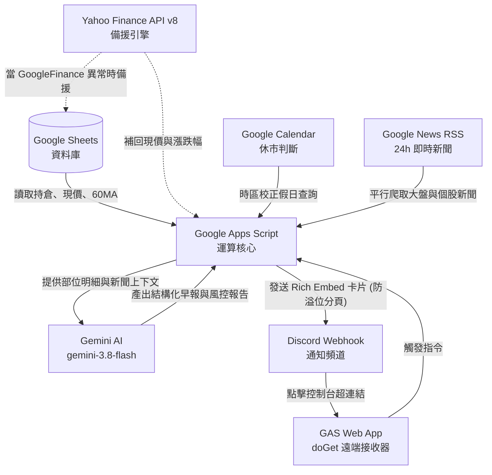

# 📈 個人投資監控助理 (Investment Monitor Bot) v15.3 (Gemini 3.8 & Dual Fallback Edition)

這是一個基於 **Google Sheets**、**Google Apps Script** 與 **Gemini AI** 打造的個人自動化投資監控與 AI 分析系統。透過 Discord Webhook 進行多市場的即時推播，並附帶專屬的 Discord 手機版互動控制台。

> [!IMPORTANT]
> **v15.3 重大升級說明 (Gemini 3.8 & Dual Fallback Edition)**：
> 1. **最新旗艦模型升級 (Gemini 3.8 Flash)**：全面採用最新 **Gemini 3.8 Flash** 模型，並配置 `thinkingLevel: 'low'` 思考耗時控制，杜絕 GAS 網路請求卡住或逾時。
> 2. **試算表專屬雙保險自訂函數**：內建 `=GET_PRICE(symbol, market)` 與 `=GET_CHANGE(symbol, market)` 試算表公式專用函數，在 GoogleFinance 故障（如 `0050`）或虛擬貨幣（如 `BTCTWD`）時直接無縫接管，徹底解決畫面 `#N/A` 的問題。
> 3. **精準實時單日漲跌幅**：直接對齊 Yahoo 官方 `regularMarketChangePercent` 實時變動率，杜絕查詢區間導致的月度累積漲跌偏差。
> 4. **底層架構加固 (Hardening)**：修正 `CacheService` 21,600 秒上限例外、Discord Embed Field 1024 字元溢位自動分頁、平均成本型態轉換防 `NaN` 污染、昨日收盤價防除零保護、以及美股跨時區休市日曆檢測校正。
> 5. **全端安全性防護**：金鑰與敏感 URL 全數託管於「指令碼屬性」，Yahoo 備援模組內建字元白名單過濾防注入與 WAF 防火牆偽裝。

---

## ✨ 核心功能

*   **🌍 多市場支援**：支援台股 (`TW`)、美股 (`US`)、加密貨幣 (`Crypto`) 的即時報價、均線回測與資產管理。
*   **📊 雙模監控**：支援「個股持倉損益計算」與「純指數點位監控（持股設為 0）」。
*   **🔄 雙引擎行情備援 (GoogleFinance + Yahoo Finance)**：
    *   平日優先使用 GoogleFinance 原生高速資料庫。
    *   遇到 `0050` 等 Google 伺服器故障標的時，自動毫秒級切換至 Yahoo Finance API v8 補回現價與漲跌幅。
    *   提供試算表自訂公式（`GET_PRICE` / `GET_CHANGE`），使 Google Sheets 儲存格告別 `#N/A`。
*   **🔔 智慧雙重警報**：
    *   **自訂波動門檻**：可針對個別標的設定大漲/大跌通知門檻（預設 3%, 5%, 10%），內建 30 分鐘防洪冷卻。
    *   **季線 (60MA) 觸及警報**：當股價進入季線上下 1% 範圍時，主動通知「回測」或「挑戰」狀態（內建 6 小時防洪冷卻）。
*   **🤖 盤後 AI 技術與風控分析**：
    *   自動統整當日持倉明細、累計總損益、單日漲跌幅及 60MA 季線。
    *   由 Gemini AI 扮演客觀的量化投資顧問，結合持倉狀態進行技術面與部位風險分析，給予專業嚴謹的避險或切入建議。
*   **🌅 盤前 AI 總經與個股新聞早報**：
    *   平行爬取 Google News 過去 24 小時的即時新聞（`UrlFetchApp.fetchAll` 平行加速 90% 以上）。
    *   **大盤總經宏觀視野**：優先抓取美國聯準會 (Fed)、S&P 500、CPI 以及台股大盤、總經與台積電等核心事件。
    *   由 Gemini 進行結構化摘要，嚴守防幻覺原則，生成 400 字以內極易讀的盤前早報。
*   **🛌 智慧休市判斷**：自動連接 Google Calendar 的美國與台灣國定假日行事曆，並依目標市場時區校正查詢區間，休市期間自動暫停發送日報與 AI 分析。
*   **🎛️ Discord 遠端互動控制台**：
    *   一鍵推播控制台至 Discord 頻道。
    *   在手機 Discord 上點擊連結即可透過 GAS Web App 直接遠端觸發：盤前早報、盤後 AI 分析、數據日報或即時波動檢查。

---

## 🛠️ 系統架構

---

## 📝 Google Sheet 試算表結構設定

請確保試算表的工作表名稱為 **`Discord_Bot`**，欄位配置如下：

| 欄位 (Column) | 欄位名稱 | 填寫說明 | 推薦整欄通用公式 |
| :--- | :--- | :--- | :--- |
| **A (1)** | 代號 (Symbol) | 股票或加密貨幣代號 | `TPE:0050`, `VOO`, `BTCTWD` |
| **B (2)** | 市場 (Market) | 所屬市場分類（大寫） | `TW`, `US`, `Crypto` |
| **C (3)** | 股數 (Quantity) | 持有股數（若為 `0` 代表純監控指數，空白則忽略該列） | `1000` 或 `0` |
| **D (4)** | 平均成本 (Avg Cost) | 平均買入成本價 | `620.5` |
| **E (5)** | 現價 (Current Price) | 自動雙引擎查價（支援台股、美股、加密貨幣） | `=IFERROR(IF(B2="Crypto", GOOGLEFINANCE("CURRENCY:"&A2), GOOGLEFINANCE(A2, "price")), GET_PRICE(A2, B2))` |
| **F (6)** | 累積總損益 | 計算累計報酬率（防呆設定為百分比） | `=IFERROR((E2-D2)/D2, 0)` |
| **G (7)** | 單日漲跌幅 | 當日股價漲跌幅（支援加密貨幣與備援） | `=IFERROR(IF(B2="Crypto", (E2 - GOOGLEFINANCE("CURRENCY:"&A2, "closeyest")) / GOOGLEFINANCE("CURRENCY:"&A2, "closeyest"), GOOGLEFINANCE(A2, "changepct")/100), GET_CHANGE(A2, B2))` |
| **H (8)** | 最後狀態紀錄 | **請保留空白**（程式會自動寫入警報標記以做冷卻判斷） | `📈 大漲 >3%` (程式寫入) |
| **I (9)** | 交易手續費率 | 計算預估淨損益時扣除的交易磨損費率 | `0.001425` |
| **J (10)** | 自訂波動門檻 | 該標的專屬的波動警報值（若留空則套用預設的 3/5/10%） | `0.02` (代表 2% 異動即警報) |
| **K (11)** | 匯率與保留區 | **特別注意：K2 儲存格**必須填入「美金兌台幣匯率」 | `32.07` |
| **L (12)** | 季線 60MA | 60 日移動平均線價格，可用於觸發季線警報 | `=AVERAGE(QUERY(GOOGLEFINANCE(A2, "price", TODAY()-100, TODAY()), "select Col2 order by Col1 desc limit 60"))` |

---

## 🧩 試算表自訂函數 (Custom Functions)

系統在 `Code.js` 中內建了兩個專為 Google Sheets 打造的自訂函數，可直接在儲存格中使用：

*   **`=GET_PRICE(symbol, market)`**：
    *   直接向 Yahoo Finance 取得該標的最新現價（若為 `BTCTWD` 會自動換算為台幣回傳）。
    *   範例：`=GET_PRICE("0050", "TW")` 或 `=GET_PRICE("BTCTWD", "Crypto")`
*   **`=GET_CHANGE(symbol, market)`**：
    *   直接向 Yahoo Finance 取得該標的真實單日漲跌率（回傳小數點比例，例如 `-0.0218` 即 `-2.18%`）。
    *   範例：`=GET_CHANGE("0050", "TW")`

---

## 🔑 安全設定與環境變數

本系統使用 Google Apps Script 的「指令碼屬性 (Script Properties)」存放敏感金鑰與設定，防止任何程式碼在 GitHub 等版控平台上外洩：

### 1. 新增指令碼屬性步驟
1. 在 Google Sheets 選單中點選「擴充功能」 $\rightarrow$ 「Apps Script」。
2. 點選左側選單的 **「專案設定」** ⚙️ (齒輪圖示)。
3. 下拉到 **「指令碼屬性」** 區塊，新增以下四組欄位：
   * **屬性**：`DISCORD_WEBHOOK_URL`  
     **值**：`https://discordapp.com/api/webhooks/您的WebhookID/您的WebhookToken`
   * **屬性**：`GEMINI_API_KEY`  
     **值**：`您的 Gemini API Key` (至 Google AI Studio 免費申請)
   * **屬性**：`WEB_APP_KEY`  
     **值**：`自訂一組網頁密鑰` (例如: `10083abc`，用於防止他人惡意呼叫您的 Web App API)
   * **屬性**：`MANUAL_WEB_APP_URL`  
     **值**：`您的 GAS Web App 網址` (用於發送 Discord 互動控制台超連結的跳轉連結)
4. 點擊 **「儲存指令碼屬性」**。

---

## ⏰ 自動化排程與發布設定

若要使系統在背景自動發送早報與監控股價，請於 Apps Script 左側選單點選 **「觸發器 (Triggers)」** ⏰ 並進行以下設定：

| 執行函數 | 活動來源 | 時間型態 | 建議執行時間 (台灣時間) |
| :--- | :--- | :--- | :--- |
| `checkStockPrice` | 時間驅動 | 分鐘計時器 | 每 10 分鐘 或 15 分鐘一次 |
| `morningBriefingTW` | 時間驅動 | 特定時間 | 每週一至週五 上午 8:00 至 9:00 |
| `morningBriefingUS` | 時間驅動 | 特定時間 | 每週一至週五 晚上 8:30 至 9:30 |
| `sendTwDailyReport` | 時間驅動 | 特定時間 | 每週一至週五 下午 3:30 至 4:30 |
| `sendUsDailyReport` | 時間驅動 | 特定時間 | 每週二至週六 早上 6:00 至 7:00 |
| `agentDailyAnalysisTW` | 時間驅動 | 特定時間 | 每週一至週五 下午 4:30 至 5:30 (收盤 AI 分析) |
| `agentDailyAnalysisUS` | 時間驅動 | 特定時間 | 每週二至週六 早上 7:00 至 8:00 (收盤 AI 分析) |

---

## 🧪 系統偵錯與檢測工具

本專案內建了數個便於檢測的工具函數：
* **`testYahooFallback()`**：執行後會獨立測試 Yahoo Finance API 對 `0050`、`0050.TW`、`2330.TW` 與 `VOO` 的行情抓取狀況與回應速度，確認備援機制是否正常。
* **`testProperties()`**：確認環境變數屬性是否有被 GAS 正確讀取，並輸出部分遮罩後的內容以供核對。
* **`testGemini()`**：獨立測試與 Gemini 3.8 API 的連線與回應時間。
* **`sendDashboard()`**：手動執行此函數，會立刻發送一封「最新互動控制台 Embed 卡片」至您的 Discord，便於手機遠端一鍵操作。
